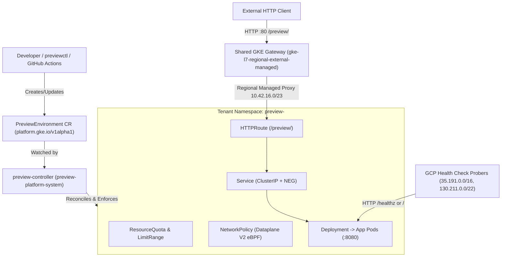

# Architecture & Design Decisions — GKE Ephemeral Environment Platform

## 1. Overview

The **GKE Ephemeral Environment Platform** is an Internal Developer Platform (IDP) built on Google Kubernetes Engine (GKE) that provisions isolated, short-lived preview environments on demand for pull requests, feature demonstrations, and debugging workflows.

Developers request an environment either declaratively via a `PreviewEnvironment` Kubernetes custom resource (`platform.gke.io/v1alpha1`) or imperatively via the `previewctl` CLI / GitHub Actions workflow. A custom Go controller (`preview-controller`) validates the specification, creates a dedicated tenant namespace (`preview-<name>`), enforces multi-tenant compute quotas (`ResourceQuota`, `LimitRange`) and eBPF network isolation (`NetworkPolicy`), deploys the application `Deployment` and `Service`, attaches a per-environment `HTTPRoute` to a shared GKE Gateway (`gke-l7-regional-external-managed`), verifies backend health and route acceptance, exposes a live preview URL, and automatically tears down expired environments when their TTL elapses or when the associated GitHub Pull Request closes.

---

## 2. Official Documentation Research & Platform Trade-offs

Before designing the infrastructure and control plane, current Google Cloud and Kubernetes Gateway API specifications were reviewed:

- **GKE Gateway API Concepts**: `https://cloud.google.com/kubernetes-engine/docs/concepts/gateway-api`
- **Deploying GKE Gateways**: `https://cloud.google.com/kubernetes-engine/docs/how-to/deploying-gateways`
- **Creating GKE with Terraform**: `https://cloud.google.com/kubernetes-engine/docs/quickstarts/create-cluster-using-terraform`

### 2.1 GKE Standard (Zonal + Dataplane V2) vs. GKE Autopilot

We evaluated GKE Autopilot first against GKE Standard in `us-west4` / `us-west4-a`:

| Criterion | GKE Autopilot (`us-west4`) | GKE Standard Zonal (`us-west4-a`) + Dataplane V2 | Decision |
|---|---|---|---|
| **Control Plane Cost** | Free for 1st cluster via GKE Free Tier | Free for 1st zonal cluster via GKE Free Tier | Tie ($0/hr management fee) |
| **Pod Provisioning Latency** | **60–120s** per scale-up event while Autopilot provisions new backend VMs | **1–3s** on warm `e2-standard-2` nodes | **Standard wins** for ephemeral preview UX & scale testing |
| **ResourceQuota & LimitRange Behavior** | Autopilot mutating webhook rounds general-purpose Pod requests up to `250m` CPU / `512Mi` memory minimums, interfering with fine-grained `LimitRange` defaults (`50m`/`64Mi`) | Exact Kubernetes admission semantics; `LimitRange` defaults and `ResourceQuota` ceilings behave deterministically | **Standard wins** for T05 resource policy fidelity |
| **NetworkPolicy Enforcement** | Mandatory Dataplane V2 (Cilium eBPF) | Native Dataplane V2 (`datapath_provider = "ADVANCED_DATAPATH"`, Cilium eBPF) | Tie (identical eBPF enforcement) |
| **Gateway API Support** | Built-in (`CHANNEL_STANDARD`) | Built-in (`gateway_api_config { channel = "CHANNEL_STANDARD" }`) | Tie |
| **Compute Cost** | Billed per mutated Pod request (minimum 250m vCPU / 512Mi per pod) | 2 × `e2-standard-2` nodes (~$0.134/hr total = ~$3.22/day) hosting controller + up to 10+ concurrent preview environments | **Standard wins** for predictable multi-environment density |

**Selected Decision**: Provision a **zonal GKE Standard cluster in `us-west4-a`** with:
- `datapath_provider = "ADVANCED_DATAPATH"` (GKE Dataplane V2 / Cilium eBPF for native `NetworkPolicy` enforcement without Calico overhead).
- `gateway_api_config { channel = "CHANNEL_STANDARD" }` (native GKE Gateway API controller).
- A single managed node pool of 2 × `e2-standard-2` (4 vCPUs, 16 GB memory total, pd-balanced disks).

### 2.2 GKE GatewayClass Selection: `gke-l7-regional-external-managed` vs. `gke-l7-global-external-managed`

GKE provides multiple GatewayClasses for external HTTP(S) traffic:

1. **`gke-l7-regional-external-managed` (Selected)**:
   - Provisions a **Regional External Application Load Balancer** backed by managed Envoy proxies in `us-west4`.
   - Requires a dedicated proxy-only subnet in `us-west4` with `purpose = "REGIONAL_MANAGED_PROXY"` and `role = "ACTIVE"` (`10.42.16.0/23`).
   - **Why selected**: Route updates (`HTTPRoute` additions/deletions) only program the regional Envoy proxy pool in `us-west4` rather than propagating across Google's global edge points of presence, cutting route convergence time significantly. It also supports full Gateway API `URLRewrite` (`ReplacePrefixMatch`) filters and keeps all data-plane resources strictly within `us-west4`.
2. **`gke-l7-global-external-managed` (Alternative)**:
   - Provisions a Global External Application Load Balancer using anycast IP. Does not require a proxy-only subnet, but route programming takes longer (3–7 minutes) due to global edge propagation.

### 2.3 Cross-Namespace `HTTPRoute` Attachment

To avoid provisioning a separate cloud load balancer per preview environment (which would cost ~$18/month per environment, exhaust `FORWARDING_RULES` quotas, and take minutes per environment):

- A single shared `Gateway` named `preview-shared-gateway` is deployed in the `preview-platform-system` namespace.
- Its HTTP listener (`port: 80`) sets `allowedRoutes.namespaces.from: Selector` matching namespaces labeled with `platform.gke.io/managed-by: preview-controller`.
- For each `PreviewEnvironment`, the controller creates a tenant namespace `preview-<name>` carrying that label and reconciles an `HTTPRoute` inside `preview-<name>` whose `parentRefs` attach to `preview-shared-gateway` in `preview-platform-system` and whose `backendRefs` point to the local `Service` in `preview-<name>`.
- Because each `HTTPRoute` lives in the **same namespace** as its target `Service`, no cross-namespace `ReferenceGrant` is needed while still achieving strict namespace-per-environment isolation.

### 2.4 URL Strategy & Public HTTP Limitation

Because a custom DNS domain and TLS certificate authority cannot be assumed in an arbitrary developer GCP project:

- **Primary URL Scheme (Zero External DNS Dependency)**:
  `http://<GATEWAY_EXTERNAL_IP>/preview/<env-name>`
  Each environment's `HTTPRoute` matches `PathPrefix: /preview/<env-name>` and configures a `URLRewrite` (`ReplacePrefixMatch: /`) filter. In addition, the sample application's HTTP router natively accepts both `/...` and `/preview/<env-name>/...` paths so that `/`, `/healthz`, `/readyz`, and `/version` work identically regardless of proxy path normalization.
- **Explicit TLS Limitation**:
  The shared Gateway exposes **HTTP on port 80 without TLS**. HTTPS is **not** claimed or enabled because no verified domain name exists for Google-managed certificate provisioning. In production with a registered domain (e.g., `*.preview.example.com`), a HTTPS listener (`port: 443`) backed by Certificate Manager or a `ManagedCertificate` should be attached to `preview-shared-gateway`.

---

## 3. VPC-Native Networking & Isolation Design

### 3.1 Dedicated VPC & Non-Conflicting CIDR Allocation

All networking is isolated in a dedicated custom-mode VPC (`gke-ephemeral-env-vpc`) in `us-west4`, leaving the project's `default` VPC (`10.182.0.0/20`) untouched:

| Network Component | Name | CIDR / Range | Purpose |
|---|---|---|---|
| Primary Node Subnet | `gke-ephemeral-env-nodes` | `10.42.0.0/20` | GKE node primary internal IPs (4,096 IPs) |
| Pod Secondary Range | `gke-ephemeral-env-pods` | `10.42.128.0/17` | VPC-native alias IPs for Pods (32,768 IPs) |
| Service Secondary Range | `gke-ephemeral-env-services` | `10.43.0.0/20` | ClusterIP Service range (4,096 IPs) |
| Regional Managed Proxy Subnet | `gke-ephemeral-env-proxy` | `10.42.16.0/23` | Regional External ALB Envoy proxies (`REGIONAL_MANAGED_PROXY`, `ACTIVE`) |
| Control Plane CIDR | Master IPv4 block | `172.16.0.32/28` | GKE control plane peering range |

### 3.2 NetworkPolicy & GKE Load Balancer Health Checks

In each tenant namespace (`preview-<name>`), the controller creates a `NetworkPolicy` (`preview-isolation`) enforced by GKE Dataplane V2 (Cilium eBPF):

- **Pod Selector**: `{}` (applies to all pods in the preview namespace).
- **Policy Types**: `["Ingress"]`.
- **Allowed Ingress Rules** (on application TCP port, default `8080`):
  1. **Intra-namespace pods**: `from: [{ podSelector: {} }]` — allows pods within the *same* preview environment to communicate if needed.
  2. **Google Cloud Health Check Probers**: `from: [{ ipBlock: { cidr: 35.191.0.0/16 } }, { ipBlock: { cidr: 130.211.0.0/22 } }]` — required because GKE Gateway uses Container-Native Load Balancing (Standalone NEGs) where health check probes hit Pod IPs directly.
  3. **Regional Managed Envoy Proxies**: `from: [{ ipBlock: { cidr: 10.42.16.0/23 } }]` — allows the shared Regional External Application Load Balancer in `us-west4` to forward matched HTTP requests to the backend Pod IPs.
- **Blocked Traffic**:
  Any Pod in another preview namespace (whose source IP belongs to the Pod secondary range `10.42.128.0/17`) or any Pod in `default` is **denied** by default.

---

## 4. Custom Resource Definition (`PreviewEnvironment`) & Controller Lifecycle

### 4.1 API Specification (`platform.gke.io/v1alpha1`)

`PreviewEnvironment` is a **Cluster-scoped** custom resource (`scope: Cluster`, shortName `pe` / `preview`). Making `PreviewEnvironment` cluster-scoped aligns with Kubernetes ownership semantics: a cluster-scoped resource represents a tenant environment that provisions and owns a cluster-scoped `Namespace` (`preview-<name>`).

#### `spec` Fields
- `environmentName` (optional override; defaults to `metadata.name`, DNS-1035 label validated).
- `prNumber` (`int`, optional, `>= 1`) & `repository` (`string`, e.g., `devenes/gke-ephemeral-environment-platform`) & `commitSHA` (`string`) & `developer` (`string`).
- `image` (`string`, required): Container image reference; validated by both CEL / OpenAPI schema rules and controller policy against the allowed registry prefix (`us-west4-docker.pkg.dev/your-gcp-project-id/gke-ephemeral-env/`) and explicit tag or `@sha256:` digest (rejecting `:latest` or untagged images).
- `ttlSeconds` (`int32`, default `3600`, min `60`, max `86400`): Time-to-live in seconds before automatic expiration and cleanup.
- `replicas` (`int32`, default `1`, min `1`, max `3`): Desired application pod count.
- `port` (`int32`, default `8080`, min `1024`, max `65535`): Container HTTP listening port (must be non-privileged `>= 1024`).
- `resources`: CPU/memory requests and limits for each replica, bounded by per-pod and per-namespace maximums (e.g., max `500m` CPU / `512Mi` memory per pod; namespace quota `1000m` CPU / `1Gi` memory).
- `env` (`[]EnvVar`): Controlled key/value environment variables (rejects reserved system keys or unsafe configurations; no volume mounts, hostPath, or securityContext overrides are exposed in the CRD).

#### `status` Fields
- `phase`: `Pending` | `Provisioning` | `Ready` | `Failed` | `Deleting` | `Expired`
- `observedGeneration`: Last reconciled `metadata.generation`
- `namespace`: Managed namespace name (`preview-<name>`)
- `deploymentName`, `serviceName`, `httpRouteName`: Child resource identifiers
- `previewURL`: External HTTP endpoint (`http://<GATEWAY_IP>/preview/<name>`)
- `readyReplicas`: Count of ready application pods
- `createdAt`, `readyAt`, `expiresAt`: RFC3339 timestamps
- `cleanupStatus`: Summary of finalizer/teardown progress
- `conditions`: Standard `metav1.Condition` slice (`Validated`, `NamespaceReady`, `WorkloadReady`, `RouteAccepted`, `Ready`)

### 4.2 Ownership Boundaries & Finalizer Strategy

Kubernetes garbage collection enforces strict ownership rules:
1. A cluster-scoped `PreviewEnvironment` **can** own a cluster-scoped `Namespace` via `metadata.ownerReferences`.
2. A cluster-scoped resource can also own namespaced resources, **or** the `Namespace` deletion itself cascades to all namespaced resources inside `preview-<name>`.
3. However, relying purely on Kubernetes background garbage collection of a `Namespace` makes teardown timing invisible to controller metrics and status reporting.

Therefore, `preview-controller` combines:
- **Finalizer (`preview.platform.gke.io/finalizer`) & Staged Gateway/NEG Teardown**:
  Added before provisioning any child resources. On deletion (`deletionTimestamp != nil`), the controller sets `status.phase = Deleting` and executes a staged teardown to respect GKE's asynchronous Gateway and NEG controllers:
  1. Deletes `HTTPRoute/preview-route` and `Deployment/preview-app` first while keeping `Service/preview-svc` and `Namespace/preview-<name>` intact so `sc-gateway-controller` detaches the route and deletes the regional `BackendService`.
  2. Waits until `Gateway/preview-shared-gateway` (`networking.gke.io/backend-services`) no longer references `preview-<name>`, then deletes `Service/preview-svc` and `Namespace/preview-<name>` so `gke-neg-controller` can delete the GCE `NetworkEndpointGroup` without hitting `resourceInUseByAnotherResource`.
  3. Includes a self-healing fallback for orphaned `ServiceNetworkEndpointGroup` finalizers if a `Terminating` namespace stalls after Gateway detachment, and removes `preview.platform.gke.io/finalizer` only when the `Namespace` is confirmed `NotFound`.
- **OwnerReferences & Deterministic Labels**: The `Namespace` carries an `ownerReference` pointing to the `PreviewEnvironment` as a secondary safety net, and all child resources carry deterministic names and labels (`platform.gke.io/environment: <name>`, `platform.gke.io/managed-by: preview-controller`).

### 4.3 Readiness Semantics

The controller does **not** transition `status.phase` to `Ready` until:
1. All child resources (`Namespace`, `ResourceQuota`, `LimitRange`, `NetworkPolicy`, `Deployment`, `Service`, `HTTPRoute`, `HealthCheckPolicy`) are reconciled without error.
2. The `Deployment` reports `status.readyReplicas >= spec.replicas` and `Available=True`.
3. The shared `Gateway` has an assigned external IP address (`status.addresses`) and the child `HTTPRoute` reports parent status condition `Accepted=True`.

External HTTP reachability from outside the cluster is additionally verified by our live integration test suite (`T03`, `T04`, `T06`) and by `previewctl` health probing.

---

## 5. Observability & Prometheus Metrics

The controller exposes Prometheus metrics via `controller-runtime`'s metrics server in `preview-platform-system`:
- `preview_reconcile_total{result="success|error|requeue"}` — Counter of reconciliation executions.
- `preview_environments_by_phase{phase="Pending|Provisioning|Ready|Failed|Deleting|Expired"}` — Gauge of active environments by phase.
- `preview_provisioning_duration_seconds` — Histogram measuring time from CR creation to `Ready`.
- `preview_ttl_cleanup_delay_seconds` — Histogram measuring delay between `expiresAt` and namespace deletion trigger.
- `preview_cleanup_failures_total` — Counter of cleanup/deletion errors requiring retry.

---

## 6. Key Findings from Live GKE Integration Testing & Post-Validation Teardown

During live validation on GKE (`gke-ephemeral-env-cluster`, Kubernetes `v1.36.4-gke.1495002` in `us-west4-a`) prior to infrastructure teardown:

1. **`readyAt`-Anchored Active TTL (`status.expiresAt`)**:
   GKE's regional Gateway controller (`sc-gateway-controller`) processes `HTTPRoute` attachment and NEG backend detachment asynchronously in batches (`~20–40s`). Anchoring `status.expiresAt` to `status.readyAt + spec.ttlSeconds` once `Phase=Ready` is reached (while enforcing a `180s` provisioning timeout prior to `Ready`) guarantees that cloud load-balancer control-plane synchronization never consumes a preview environment's active TTL window.
2. **Staged `HTTPRoute` -> `Gateway` Detach -> `Service`/`Namespace` Teardown**:
   Deleting a Kubernetes `Service` while GKE's regional `BackendService` still references its standalone GCE `NetworkEndpointGroup` causes `gke-neg-controller` to receive `resourceInUseByAnotherResource` from the Compute Engine API. Implementing a 4-stage finalizer workflow in `pkg/controller/reconciler.go` (deleting `HTTPRoute` first and waiting until `Gateway` annotation `networking.gke.io/backend-services` detaches the tenant namespace before deleting `Service` and `Namespace`) resolved the teardown ordering dependency.
3. **Post-Validation Teardown Status**:
   Following successful completion of all `T00`–`T14` live GKE tests, the demo infrastructure was torn down via Terraform on `2026-10-24T09:32:17Z` (see [docs/TEARDOWN.md](TEARDOWN.md)). All architectural manifests, Terraform configurations, controller code, and test artifacts remain preserved in the repository for reproducible re-provisioning.
